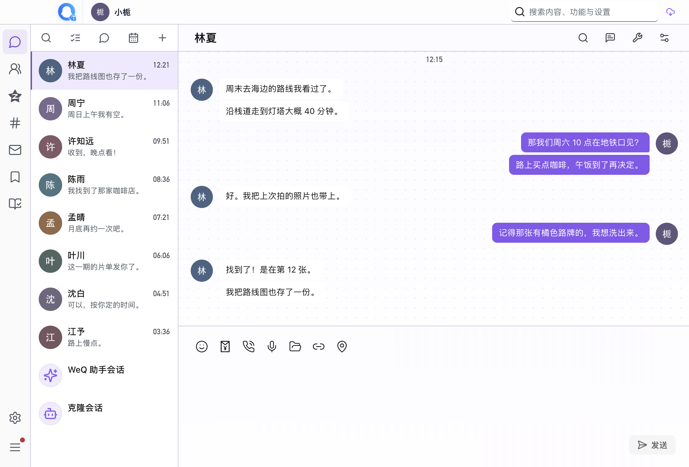
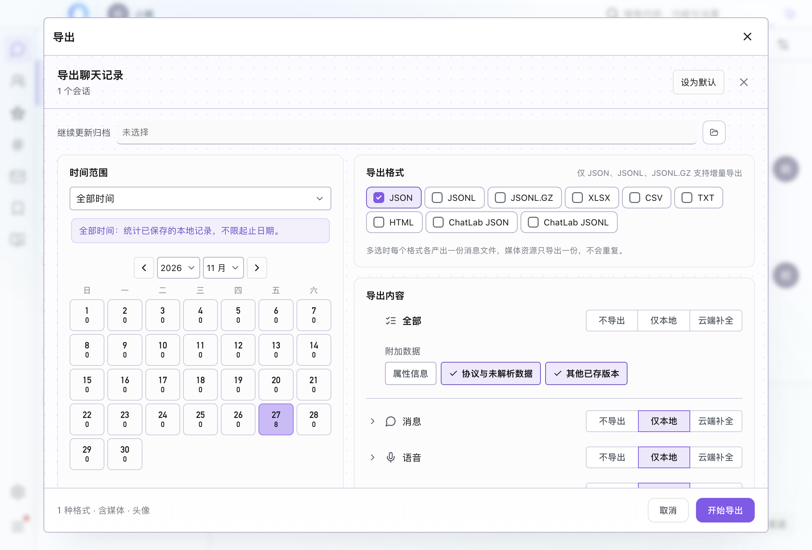
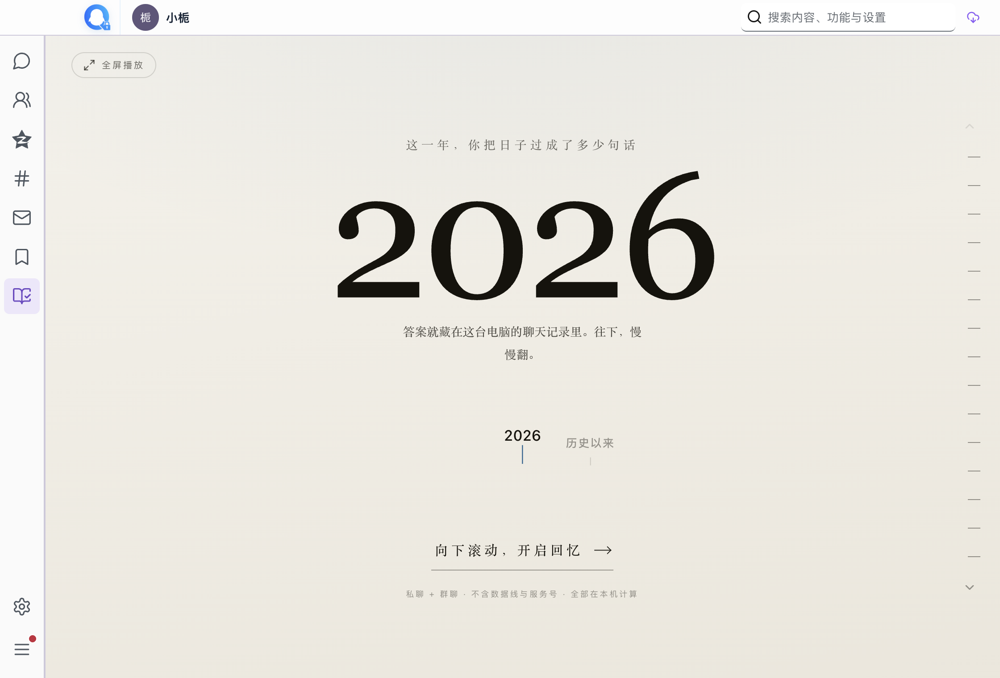

# WeQ

WeQ 是面向 QQ NT 的聊天记录管理工具。打开本机 QQ 账号或导入备份，即可浏览、搜索和导出聊天记录，也可以生成聊天分析和年度报告。

**[下载桌面版](https://github.com/weq-devs/WeQ/releases)** · [快速上手](https://weq-devs.github.io/WeqDocs/guide/getting-started) · [文档站](https://weq-devs.github.io/WeqDocs/)



## 开始使用

1. 下载适合你电脑的安装包并启动 WeQ。
2. 在账号主页选择「添加本机 QQ 账号」或「导入 QQ 备份」。
3. 按提示打开账号，在消息列表里选择一个会话。

桌面版支持 **Windows x64**、**macOS（Apple 芯片 / Intel）** 和 **Linux x64 / arm64**。 [Arch Linux 安装（AUR）](https://weq-devs.github.io/WeqDocs/guide/arch-install) · [支持的 QQ 版本](https://weq-devs.github.io/WeqDocs/guide/supported-versions)

## 浏览、导出与分析

- **浏览与搜索**　按会话回看私聊和群聊，搜索历史消息，查看记录里的图片、语音和原有消息装扮。[消息页](https://weq-devs.github.io/WeqDocs/guide/chat-view)
- **导出与归档**　选择会话和时间范围，导出为 HTML、TXT、XLSX 或 JSON 等格式，也可以一并保存媒体。[统一导出](https://weq-devs.github.io/WeqDocs/guide/export)
- **分析与年度报告**　查看私聊和群聊的活跃时段、消息趋势与成员互动，把一年的聊天记录整理成报告。[聊天分析与年度报告](https://weq-devs.github.io/WeqDocs/guide/analytics)

| 聊天记录导出 | 年度报告 |
| --- | --- |
|  |  |

## 在浏览器和手机上使用

- **桌面版内置 Web**　已在电脑上运行 WeQ 时，可以从「设置 → 服务 → 浏览器访问」开启本机浏览器入口。[Web 服务与手机连接](https://weq-devs.github.io/WeqDocs/guide/remote-web)
- **独立 WeQ Web**　适合在 NAS、服务器或 WSL 上运行，通过浏览器使用。[独立部署说明](./apps/web/README.md)
- **WeQ Remote**　用手机与电脑上的 WeQ 配对，在手机上浏览电脑里的记录。[WeQ Remote 手机端](https://github.com/weq-devs/WeQ-Remote)

## 参与开发

```sh
git clone --branch dev --recurse-submodules https://github.com/weq-devs/WeQ.git
cd WeQ
pnpm dev
```

环境要求和启动选项见[开发启动说明](https://weq-devs.github.io/WeqDocs/develop/dev-startup)。提交代码请参考[贡献指南](./CONTRIBUTING.md)。

## 社区与项目说明

[问题反馈](https://github.com/weq-devs/WeQ/issues) · [QQ 交流群](https://qm.qq.com/q/ysMZoAcC1a) · [更新日志](./CHANGELOG.md) · [免责声明与使用说明](https://weq-devs.github.io/WeqDocs/guide/disclaimer) · [许可协议](./LICENSE)

感谢 [NapNeko 团队](https://github.com/NapNeko)、[webark-im-template](https://github.com/dogxii/webark-im-template)、[QQBackup](https://github.com/QQBackup) 和所有 [WeQ 贡献者](https://github.com/weq-devs/WeQ/graphs/contributors)提供的实现参考、聊天界面模板和资料。

微信聊天记录的导出和分析可使用 [WeChatDataAnalysis](https://github.com/LifeArchiveProject/WeChatDataAnalysis)。
