**WeQ** 是面向 QQ NT 聊天记录的本地查看、导出与分析工具。

[下载](https://github.com/weq-devs/WeQ/releases) · [文档站](https://weq-devs.github.io/WeqDocs/) · [快速上手](https://weq-devs.github.io/WeqDocs/guide/getting-started) · [问题反馈](https://github.com/weq-devs/WeQ/issues) · [免责声明与使用说明](#免责声明与使用说明)

如果你需要导出和分析**微信聊天记录**：[WeChatDataAnalysis](https://github.com/LifeArchiveProject/WeChatDataAnalysis)   是相当不错的选择

欢迎加入**QQ交流群**讨论交流： [](https://qm.qq.com/q/ysMZoAcC1a)


---

## 核心功能

- <details> <summary>账号与数据库接入</summary> 支持导入备份，并按引导为所选账号获取数据库密钥。 </details>
- <details> <summary>聊天记录查看与本地编辑</summary> 支持按会话查看聊天记录，解析私聊、群聊、官方账号和频道私聊中的文字、图片、语音及消息装扮等内容。<br>编辑仅作用于本地数据，不修改 QQ 服务器；编辑或生成的内容不等同于原始消息。 </details>
- <details> <summary>消息装扮还原</summary> 显示消息原有的气泡、字体和挂件，复用已有缓存。<br>当前开发分支的装扮商城、任意装扮覆盖、独立素材保存及商城表情包密钥恢复，仅在开发运行环境中显式启用；普通模式保留消息原有装扮、已缓存表情和自定义背景。已发布版本以对应版本说明为准。 </details>
- <details> <summary>聊天记录导出</summary> 支持导出聊天记录为<strong>各种格式</strong>，json txt xlsx等等等<br> 同时支持导出联系人，我的收藏，QQ空间等等等附带资源 </details>
- **年度报告**和单聊会话分析
- 基于聊天语料的 **AI 模拟对话与群聊**，生成内容不代表本人发言
- **消息防撤回**和删除消息查看
- 聊天分析agent和MCP

| 聊天记录查看（消息装扮） | **AI 模拟对话** |
| -------------- | ---------- |
| 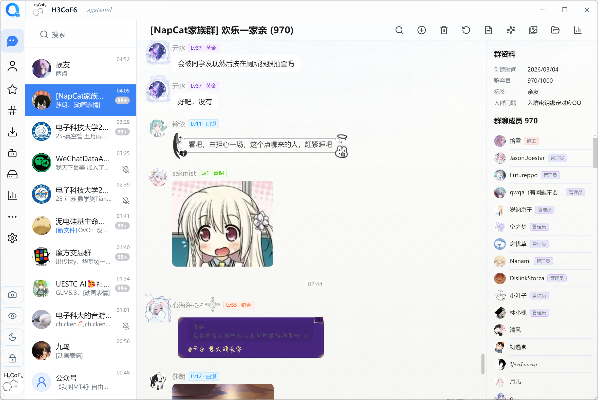 | 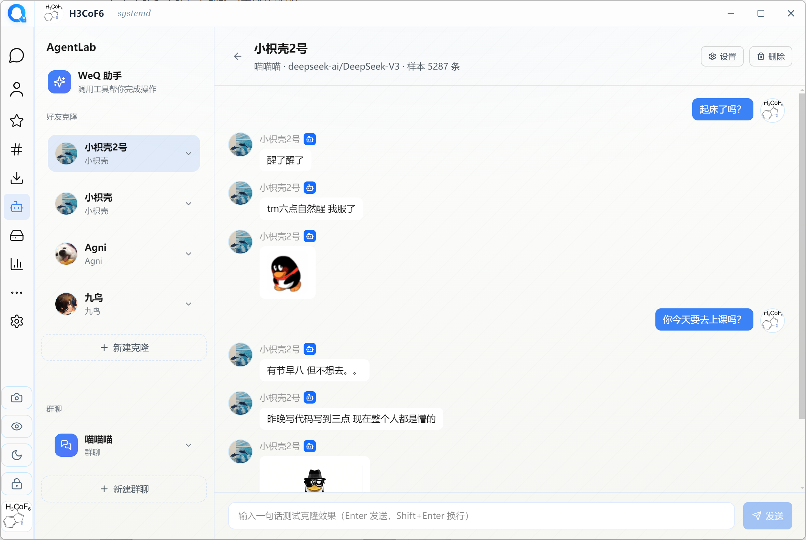 |
| **导出聊天记录** | **装扮开发工具（非普通模式）** |
| 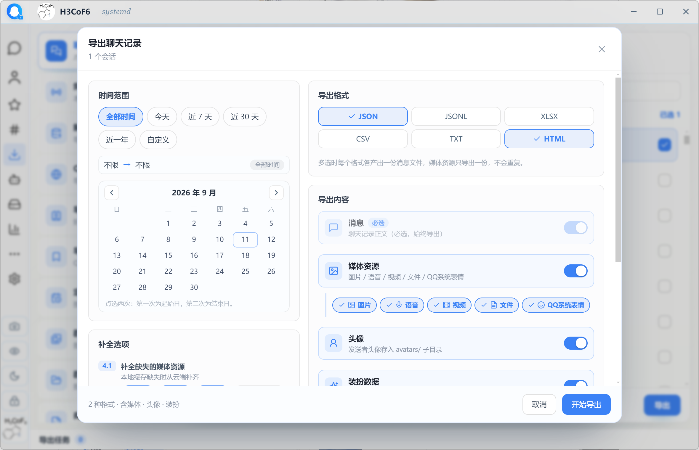 | 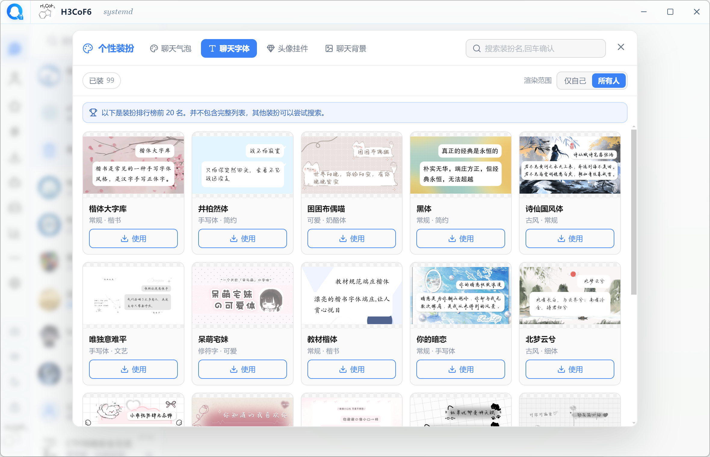 |
| **年度/历史报告**                                            | **本地编辑/新增消息**                                            |
| 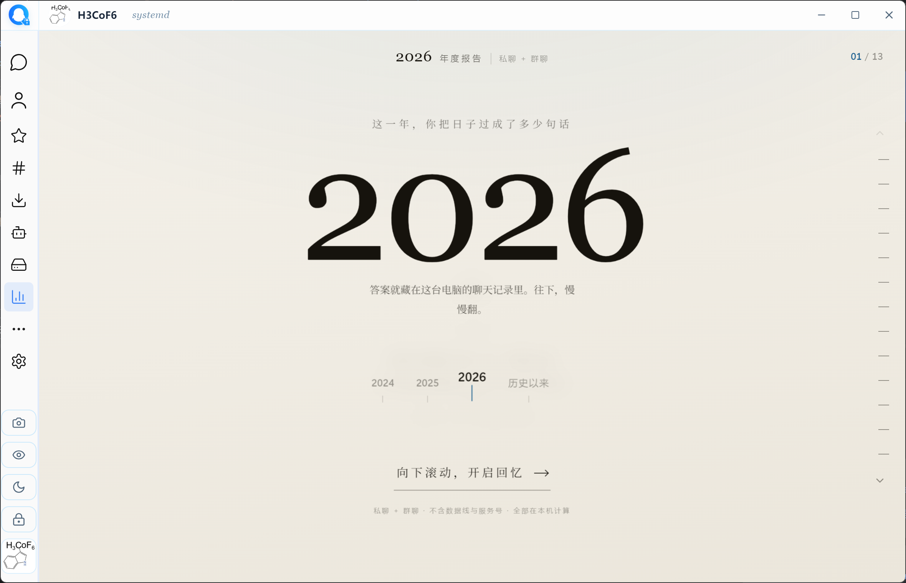 | 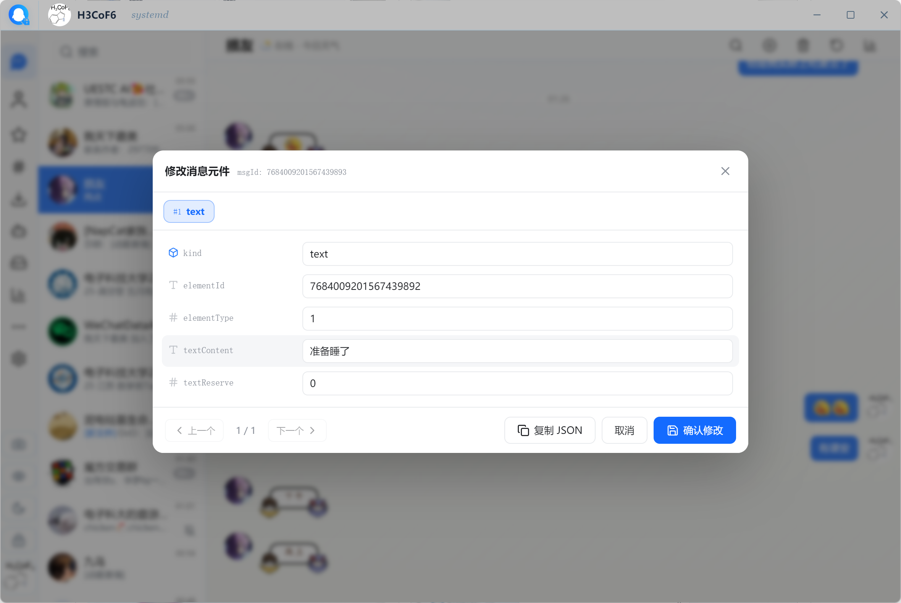 |
| **离线防撤回** | **agent助手** |
| 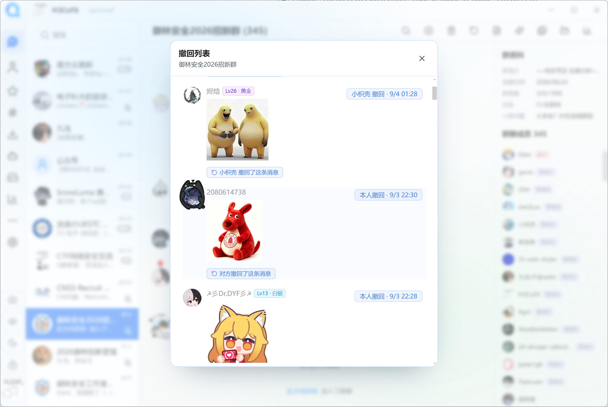 | 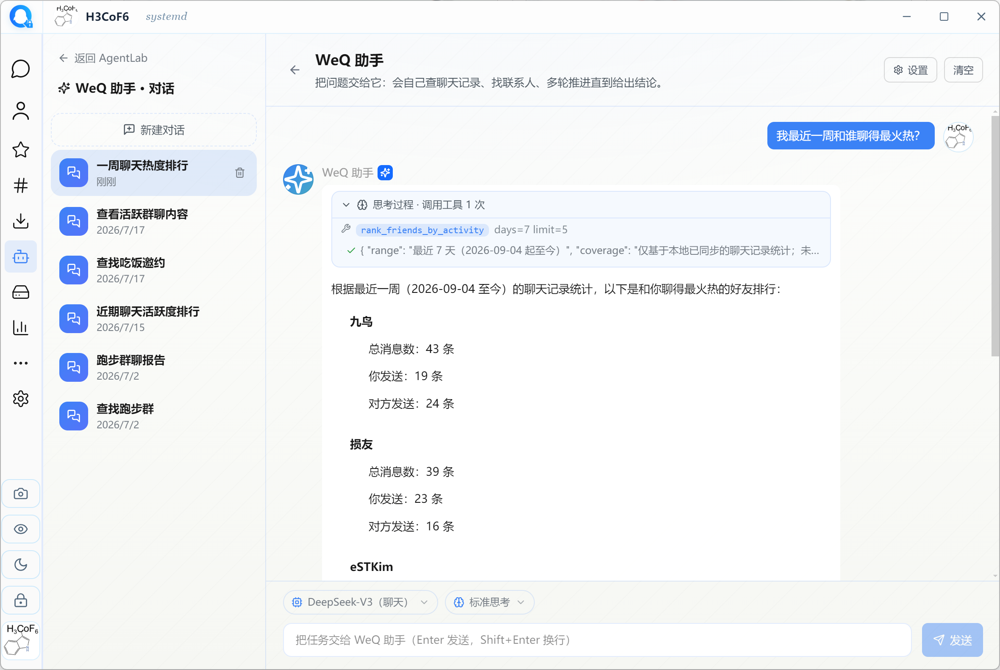 |
| **群相册查看和导出** | **QQ空间导出html** |
| 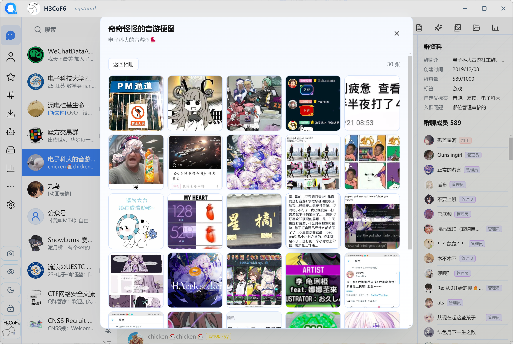 | 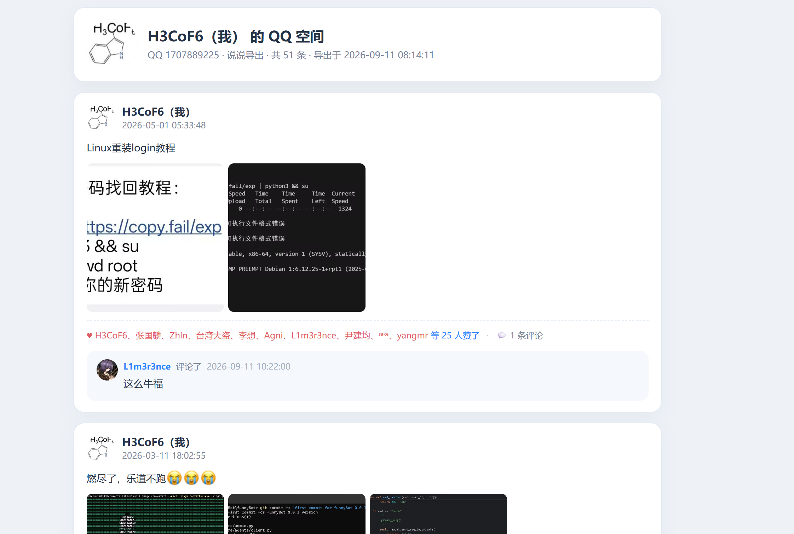 |
| **群聊/私聊分析** | **QQ缓存资源清理** |
| 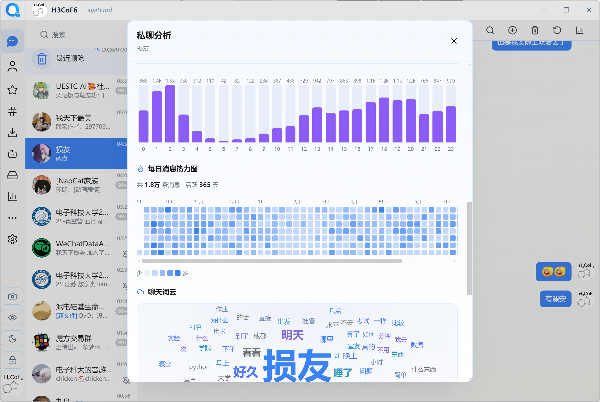 | 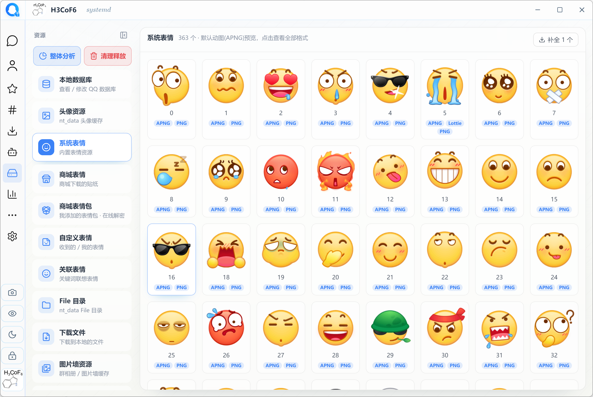 |


> 全部功能请查看[在线使用手册](https://weq-devs.github.io/WeqDocs/guide/)，手机连接见 [WeQ Remote](https://github.com/weq-devs/WeQ-Remote)。

## 免责声明与使用说明

- **非官方项目**：WeQ 由独立开发者维护，不是腾讯或 QQ 官方产品，与其不存在官方隶属或背书关系。
- **数据与素材使用**：请仅处理本人或已获合法授权的数据。项目许可证不授予对第三方软件、素材、个人信息或人格形象的额外使用、复制和传播权利。
- **编辑与 AI 内容**：本地编辑、新增消息和 AI 模拟内容不等同于原始聊天记录，也不代表对应联系人真实发言；分享时应明确标注。
- **实际操作影响**：消息编辑、删除及数据库修复等操作可能写入本地数据库，操作前请备份原始数据；发送消息、群管理等 QQ 在线操作会真实作用于 QQ，不能视为离线模拟。

功能可用性会受系统、QQ 版本、凭据及在线接口变化影响，具体支持情况以对应版本说明和实际检测为准。详细说明见[文档站的免责声明与使用说明](https://weq-devs.github.io/WeqDocs/guide/disclaimer)。

## 使用方法

1. 前往 [Releases](https://github.com/weq-devs/WeQ/releases) 下载最新版本
2. 按照引导操作获取数据库密钥 
3. 打开对应账号即可开始使用

> [!tip]
>
> **支持的设备**
>
> | 系统 | Windows            | MacOS      | Linux      |
> | ---- | ------------------ | ---------- | ---------- |
> | 架构 | x64，**不支持arm** | arm，intel | x64，arm64 |

Arch Linux 用户可以直接从 AUR 安装预编译包，不必手动下载 Release：

```bash
paru -S weq-bin
```

详见 [Arch Linux 安装（AUR）](./docs/guide/arch-install.md)。

### web版

除桌面版外还提供 **WeQ Web**，复用桌面版的业务界面与后端，原生外壳能力存在差异。适合无桌面环境的机器
（NAS / 服务器 / WSL），或想从别的设备访问。

下载 `weq-web-<版本>-<平台>.tar.gz`（每个平台一个包，**需自备 Node ≥ 22**），
解压后直接运行启动脚本即可（Windows 双击 `start.bat`，Linux/macOS 执行 `./start.sh`）：

```bash
./start.sh        # Linux / macOS
start.bat         # Windows
```

终端会打印地址和访问令牌，浏览器打开即可。默认只监听本机；
**对外暴露前请先读 [apps/web/README.md](./apps/web/README.md)**。

已运行桌面版时，也可从「设置 → WeQ 服务 → Web 与 Remote」开启内置 Web，复用当前账号，
无需再启动独立 Node 服务。手机连接与两种 Web 宿主的能力边界见[Web 服务与手机连接](./docs/guide/remote-web.md)。

#### 开发者指南

开始运行：

```bash
git clone https://github.com/weq-devs/WeQ   # 克隆仓库代码
cd WeQ
git switch dev             # 开发基于 dev，main 为发布分支

pnpm dev                   # 自动补齐依赖、native 和必要构建，启动开发服务器
```

源码开发使用 Node.js 24 LTS（最低 24），并使用根 `package.json` 锁定的 `pnpm@12.8.1`；首次构建远程网络辅助程序需要 Go。默认无需 Rust，本地 native 模式才需要其编译工具链。来源配置与缓存行为见[一行命令开发启动](./docs/develop/dev-startup.md)。

Remote 连接开发版时，电脑网页通过已有阶段协议报告已加载的代码字节和资源项数，旧版手机 App 无需升级。开发模块按需发现，不预估完整总量或百分比；正式静态网页仍使用原有资源清单与字节进度。进入实际初始化阶段后不覆盖阶段提示，界面就绪后停止启动计量，不影响后续热更新。

> native 由 [nt_helper_release](https://github.com/weq-devs/nt_helper_release) 分发，
> `pnpm dev` 默认准备 `native/pinned.json` 锚定的发布版，不预下载大装扮索引；本地源码模式仍准备自己的配套资源。
> 装扮索引由 [dress-resources](https://github.com/weq-devs/dress-resources) 独立分发，桌面与 Web 安装包不再携带三份 `.dat`，
> 索引只提供素材地址，不包含完整素材；准备、缓存与更新方式见[表情与装扮资源](./docs/guide/emoji-resources.md)，装扮开发工具的启用条件见[开发启动说明](./docs/develop/dev-startup.md)。
> native 锚点过期时需验证并升级，同时更新兼容的索引清单；反复获取同一 tag 不会延长有效期。细节见
> [原生二进制与装扮资源的分发](./docs/develop/native-artifacts.md)。

打包发布：

```bash
pnpm run build                 # = build:bot + 桌面版构建 + electron-builder（安装包）
pnpm --filter @weq/web build    # 浏览器版（助手资源服务随 Web 进程运行）
```

> 贡献代码请先阅读 [贡献指南](./CONTRIBUTING.md)  作为参考

### QQ交流群
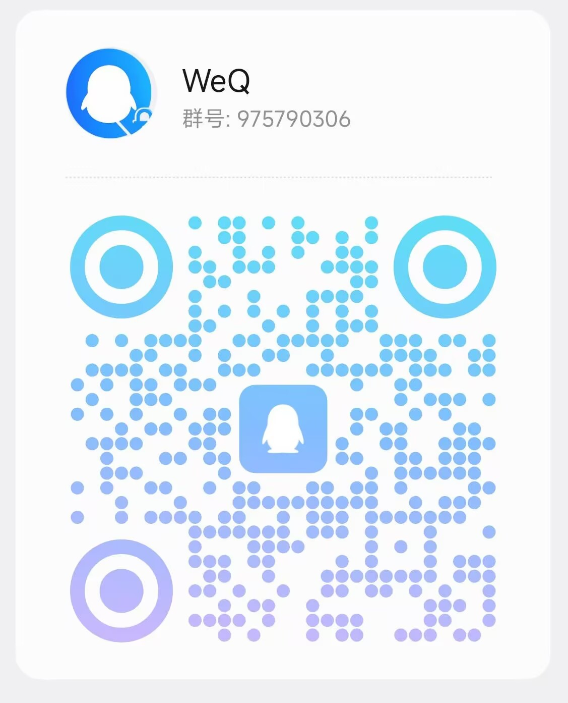

## 致谢

| 项目                                                         |                          参考                           |
| ------------------------------------------------------------ | :-----------------------------------------------------: |
| [NapNeko ](https://github.com/NapNeko)团队                   |                    **大量实现参考**                     |
| [webark-im-template](https://github.com/dogxii/webark-im-template) |                     QQ 聊天界面模板                     |
| [QQBackup](https://github.com/QQBackup)                      | 整理保存了大量资料（虽然因为某个错误导致走了4个月弯路） |

**同时也感谢每一个为WeQ及相关项目做出贡献的开发者**：

<a href="https://github.com/weq-devs/WeQ/graphs/contributors">
  
</a>

## 许可协议

本仓库的许可声明见 [LICENSE](./LICENSE)。使用与分发须遵守适用的署名、非商业性使用及相同方式共享条件。分享修改后的作品时，应按协议要求标明修改并采用相应许可；第三方组件与素材遵循各自的授权条款。
